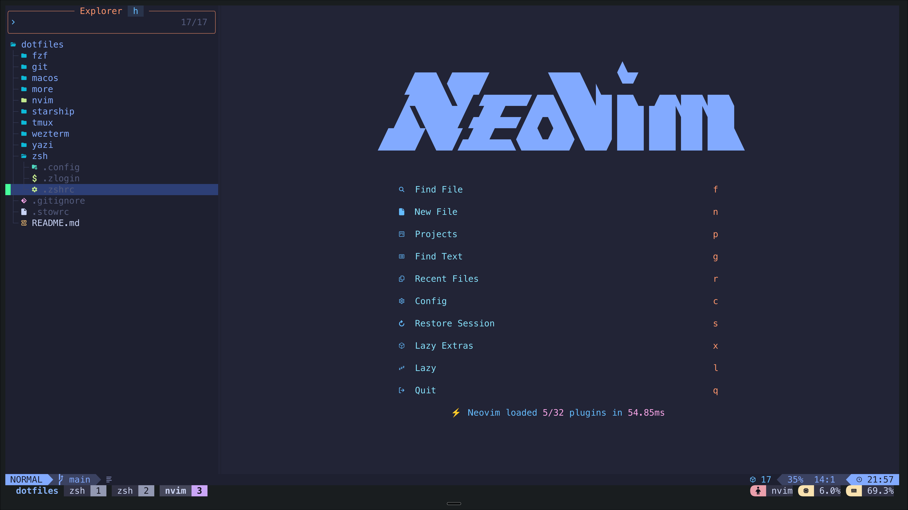
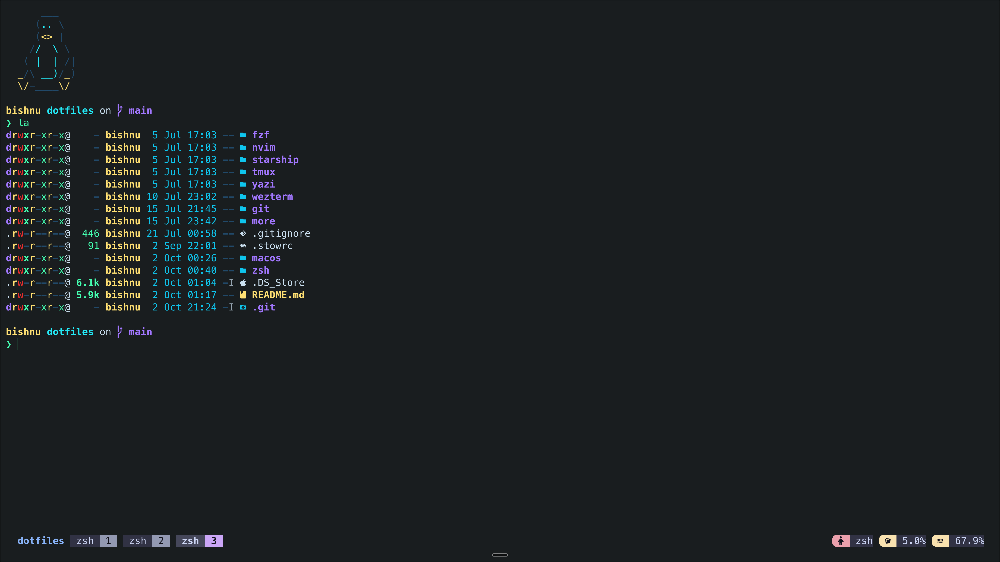
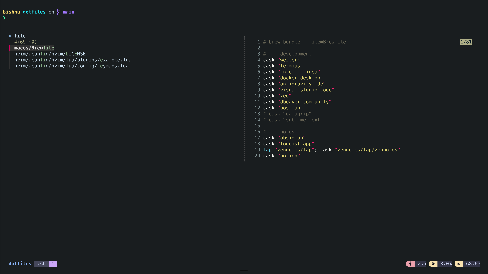
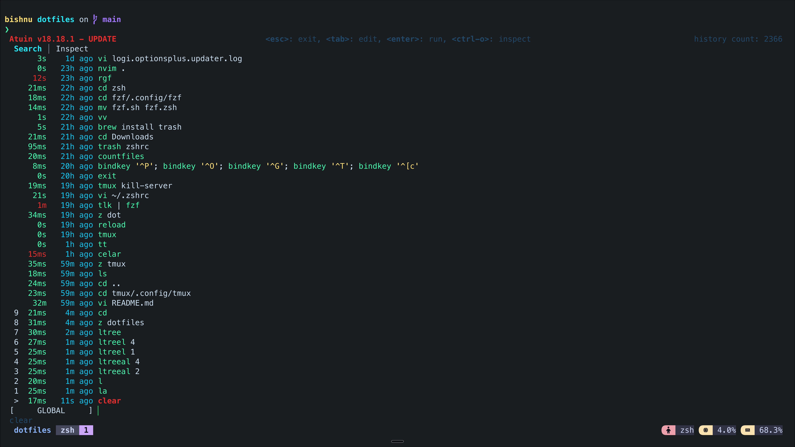

<div align="center">

```
    ██████╗  ██████╗ ████████╗███████╗██╗██╗     ███████╗███████╗
    ██╔══██╗██╔═══██╗╚══██╔══╝██╔════╝██║██║     ██╔════╝██╔════╝
    ██║  ██║██║   ██║   ██║   █████╗  ██║██║     █████╗  ███████╗
    ██║  ██║██║   ██║   ██║   ██╔══╝  ██║██║     ██╔══╝  ╚════██║
    ██████╔╝╚██████╔╝   ██║   ██║     ██║███████╗███████╗███████║
    ╚═════╝  ╚═════╝    ╚═╝   ╚═╝     ╚═╝╚══════╝╚══════╝╚══════╝
```

**Clone. Stow. Work.**

*Same terminal. Every machine. Zero setup.*


</div>

## What's this?
A modular, version-controlled terminal environment that reproduces the same
developer workflow on every new machine you log in to. Each tool lives in its own
GNU Stow package, so you can install everything with one command or pick only
what you need. Supported on macOS, Ubuntu and all major distros,
Idempotent. Safe to re-run. Doesn't nuke your existing configs.


- **Reproducible:** one repo is the single source of truth for shell, editor,
  prompt, multiplexer, file manager, and Git configuration.
- **Modular:** every top-level directory is an independent Stow package that
  mirrors `$HOME`.
- **Safe:** symlink-based, idempotent, and safe to re-run. Stow refuses to
  overwrite existing files, and machine-specific settings stay in untracked
  local files.


## What you get

| Area | Tools |
| --- | --- |
| Shell | zsh, bash, Starship prompt, atuin history, zoxide |
| Editor | Neovim (LazyVim) |
| Terminal | WezTerm, tmux |
| Files and search | yazi, fzf, fzf-git, fd, ripgrep, bat, eza |
| Git | lazygit, shared Git config |
| System | btop, procs, ncdu, duf, Nerd Font |

The full list is in `macos/Brewfile`.

<br>
<div align="center">
*Built for devs who SSH into too many machines and got tired of reconfiguring everything.*
</div>
<br>








## Quick Start

### 1. Clone

```shell
git clone https://github.com/justbixh/dotfiles.git ~/dotfiles
```

### 2. Check which tools are installed

```bash
bash ~/dotfiles/more/check.sh
```

### 3. Install tools

**macOS** (installs everything in the Brewfile; comment out what you do not need):

```bash
# install Homebrew first if needed: https://brew.sh
brew bundle --file=~/dotfiles/macos/Brewfile
```

**Ubuntu / RHEL:** install the tools reported as missing by `check.sh`
using your package manager.

### 4. Stow

```bash
# stow a single package
cd ~/dotfiles && stow zsh

# stow all
cd ~/dotfiles && stow fzf nvim starship tmux yazi wezterm git zsh

# restow (re-links everything, safe to re-run)
cd ~/dotfiles && stow --restow fzf nvim starship tmux yazi wezterm git zsh

# unstow (removes symlinks)
cd ~/dotfiles && stow --delete zsh

# dry run — see what would happen without doing it
cd ~/dotfiles && stow --simulate zsh
```

### 5. Switch to zsh

```bash
chsh -s "$(which zsh)"
# then log out and back in
```

## Offerings

|Key|Action|Status|
|---|---|---|
|`Ctrl+P`|fuzzy search and open a file in a tmux session|fzf-tmux-script|
|`Ctrl+O`|pick a folder and open it in a new (or existing) tmux session|fzf-tmux-script|
|`Ctrl+G`|jump to a frequently used folder (zoxide)|config|
|`Ctrl+T`|pick a file path and paste it on the command line|fzf default|
|`Alt+C`|pick a folder under the current directory and `cd` into it|fzf default|


## Repository layout

```
dotfiles/
├── fzf
│   └── .config/fzf
│       ├── bin
│       │   ├── ff
│       │   └── fo
│       └── fzf.zsh
├── git
│   └── .config
│       └── git
│           └── config
├── macos
│   ├── Brewfile
│   └── macos-defaults.sh
├── nvim
│   └── .config
│       └── nvim
│           ├── lua/
│           ├── .neoconf.json
│           ├── init.lua
│           ├── lazy-lock.json
│           ├── lazyvim.json
│           └── stylua.toml
├── starship
│   └── .config
│       └── starship
│           └── starship.toml
├── tmux
│   └── .config
│       └── tmux
│           └── tmux.conf
├── wezterm
│   └── .config
│       └── wezterm
│           ├── wezterm.lua
│           └── wezterm.win.lua
├── yazi
│   └── .config
│       └── yazi
│           └── yazi.toml
├── zsh
│   ├── .zshrc
│   └── .config
│       └── zsh
│           ├── functions.zsh
│           └── plugins.zsh
├── .gitignore
├── .stowrc
└── readme.md
```

> Each top-level directory is a stow package. The internal structure mirrors `$HOME`, so stow knows exactly where to place every symlink.

## post stow

```
$HOME/
  .zshrc
  .local.zshrc  # .gitignore'd
  .config/
    git/config
    nvim/
    fzf/fzf.zsh
    starship/starship.toml
    tmux/tmux.conf
    wezterm/wezterm.lua
    yazi/yazi.toml
    zsh/
      functions.zsh
      plugins.zsh
```

<div align="center">
With love, Bishnu
</div>